# 🔃 ComfyUI-LiveDev

<p align="center">
  
</p>

<p align="center">
  <strong>Developed by <a href="https://github.com/technokeys-ai">TechnoKeys</a></strong>
</p>

<p align="center">
  <a href="https://github.com/technokeys-ai/ComfyUI-LiveDev/releases"></a>
  <a href="https://registry.comfy.org"></a>
  <a href="https://github.com/technokeys-ai/ComfyUI-LiveDev/blob/main/LICENSE"></a>
  
</p>

A comprehensive development toolkit and workflow power-suite for ComfyUI. Reload custom nodes the moment their code changes, browse every workflow across ComfyUI and `custom_nodes` in a visual **Workflow Gallery**, snap nodes with **Magnetic Alignment Guides**, fold groups non-destructively with **Visual Fold**, control nodes and Subgraphs remotely with **Bypass LiveDev**, customize **12 wire routing styles & 24 visual effects**, resolve dependency conflicts with one-click rollback, and diagnose errors with **Smart Auto-Fix** — all without restarting the server.

## Quick Start

1. **Top Menu Bar Controls**: right in the top bar you get three Obsidian Glass controls side by side — **`LiveDev`** (Control Hub), **`Align Snap & Guides`** (one-click magnetic snapping toggle; hold `Shift` during drag to bypass), and **`Workflow Gallery`** (browse all workflows across ComfyUI & `custom_nodes`) — next to the live **CPU / GPU / VRAM / RAM** telemetry bar.
2. **Customize Wires & Effects**: open **`Settings → 🔃 LiveDev → Wires & Connections`** to switch live between **12 Wire Routing Styles**, **24 Wire Visual Effects**, **Per-Slot Link Hiding**, **HUD Slot Indicators**, **Slot Quick-Action Pill**, **Quick Connections**, **Focus Mode**, **CAD Jump-Over Bridges**, and **Live Execution Data Pulse**.
3. **Spotlight Command Palette**: press **`Ctrl+K`** (or **`Ctrl+Shift+P`**) anytime to launch any LiveDev tool, toggle Align Snap or Visual Fold, switch wire modes live, or jump straight to any node.
4. **Dock or Auto-Hide the Alignment Toolbar**: click the pin toggle on the floating bottom dock (or click **`Toolbar`** in the LiveDev menu) to keep it always visible or show it only when 2+ items (nodes, Subgraphs, notes, or groups) are selected.

## Visual Showcase

### Workflow Gallery (All ComfyUI, User, Blueprints, Custom Nodes & Templates)
<p align="center">
  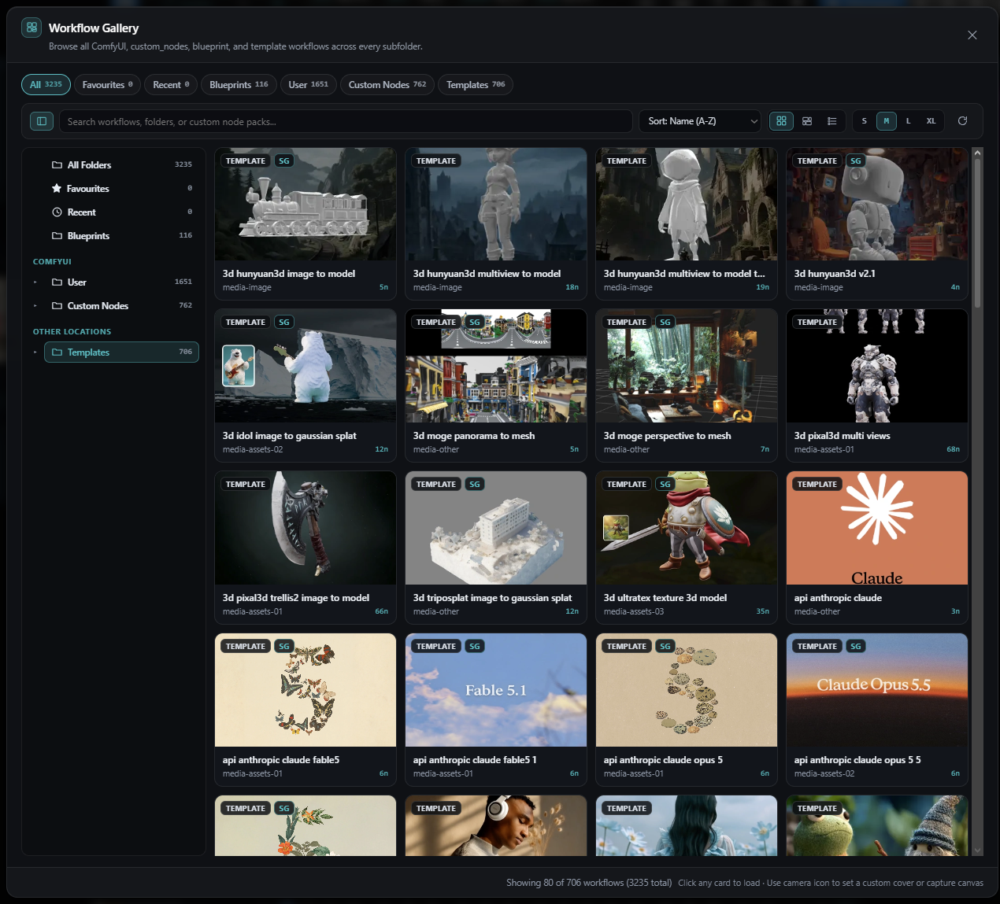
</p>

### Top Bar Control Hub & Live System Telemetry
| LiveDev Control Hub | Top Bar (LiveDev + Align Snap + Gallery + Telemetry) & Detail Popup |
| :---: | :---: |
|  | 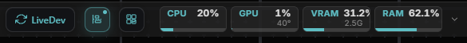<br /><br /> |

### Magnetic Align Snap & Guides · Visual Fold
| Align Snap & Equal-Spacing Guides (Hold Shift to Bypass) | Visual Fold (Non-Destructive Pill Folding) |
| :---: | :---: |
| 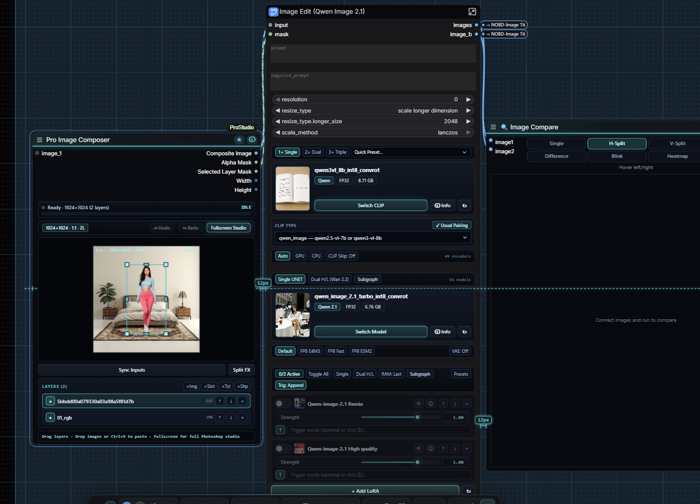 | 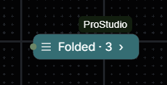 |

### Floating Alignment Dock (Dark & Light · Expanded & Collapsed)
| Dark Glass Theme (Expanded & Collapsed) | Light Glass Theme (Expanded & Collapsed) |
| :---: | :---: |
| 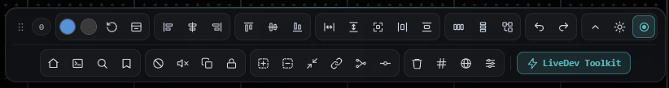<br /><br />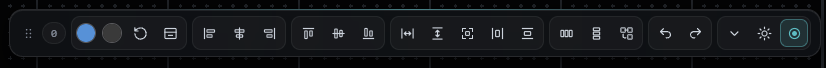 | 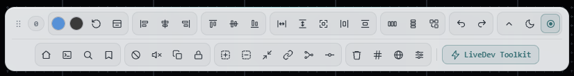<br /><br />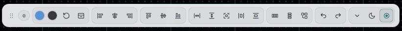 |

### Wires & Connections (24 Visual Effects + 12 Routing Styles + Slot Quick-Action Pill)
| 24 Wire Visual Effects & Animation Controls | 12 Wire Routing Styles & Hidden-Link HUD |
| :---: | :---: |
| 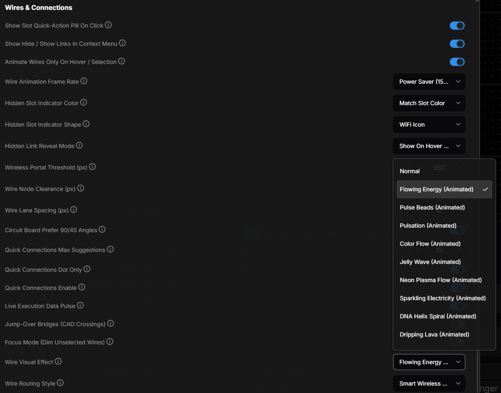 | 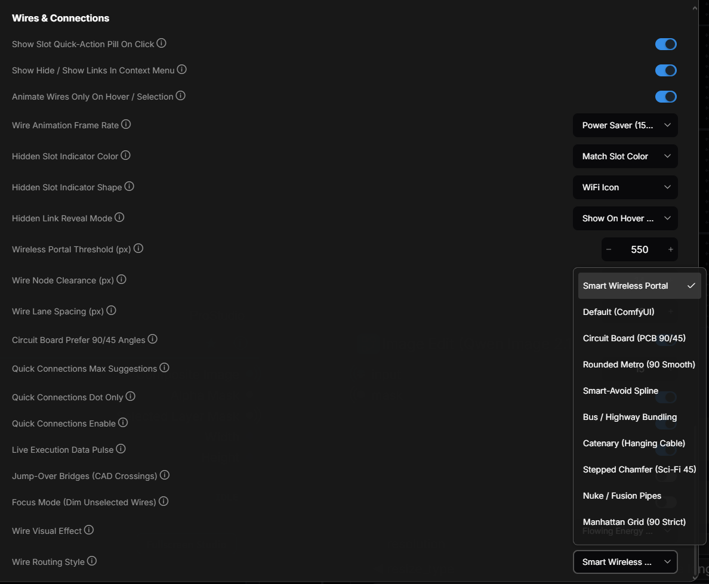 |

| Slot Quick-Action Pill (Hide, Rename, Disconnect / Delete Subgraph Slot) | Hidden Link HUD Indicator (WiFi Icon) |
| :---: | :---: |
| 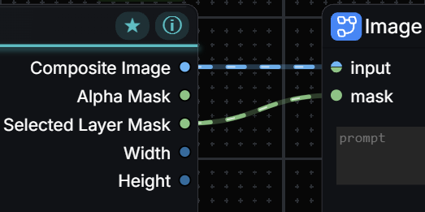 | 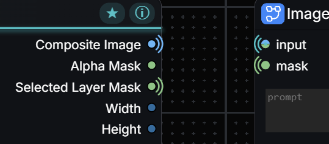 |

### LiveDev Nodes (`🔃 LiveDev/`)
| 🔀 Bypass LiveDev (Remote Control Board) | Target Picker (Filter Nodes / Groups / Subgraphs & Widget Values) |
| :---: | :---: |
| 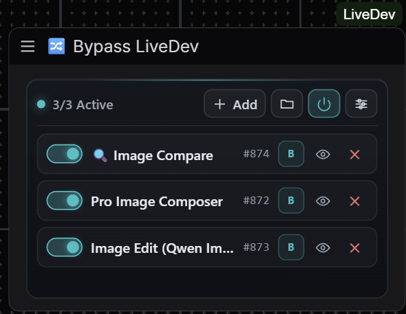 | 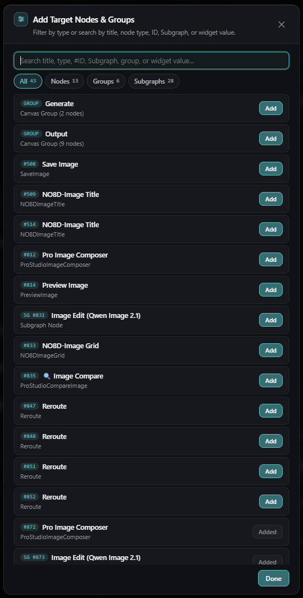 |

| 🖥 Terminal LiveDev | ⏱ Run Timer LiveDev & 🧹 Clean Memory LiveDev |
| :---: | :---: |
| 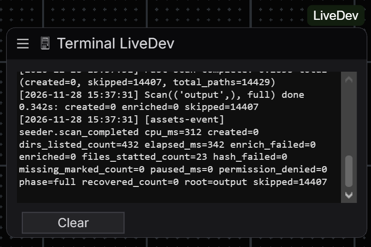 | 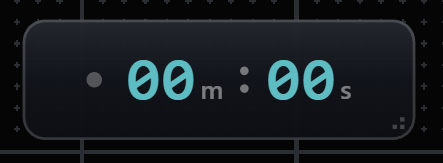<br /><br />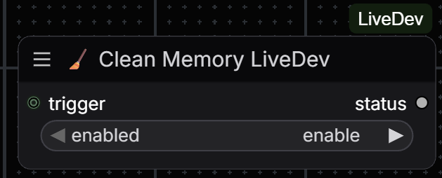 |

### Command Palette, Smart Error Card, Profiler Badges & Package Management
| Command Palette (`Ctrl+K`) | Floating Error Card + Smart Auto-Fixer & Node Timing Badge |
| :---: | :---: |
| 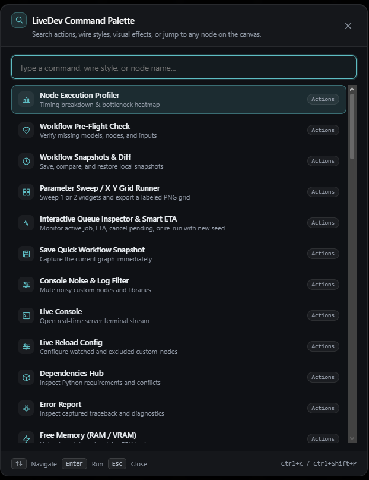 | 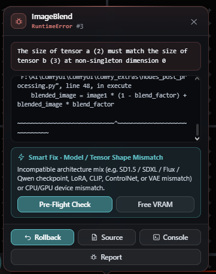<br /><br />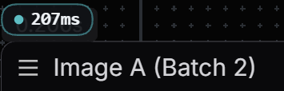 |

| Live Reload Module Config | Dependencies Manager & Rollback Hub |
| :---: | :---: |
| 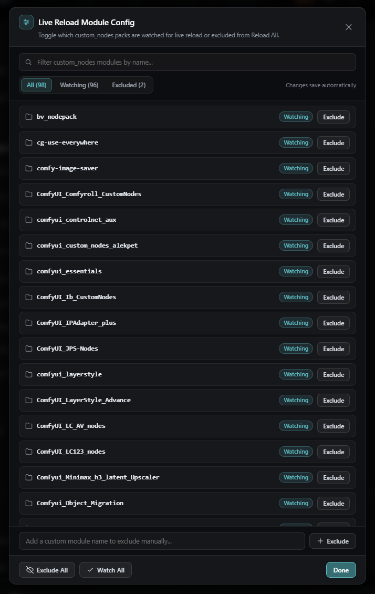 |  |

## Features

### Workflow Gallery
- **Unified multi-root discovery**: scans `Blueprints`, ComfyUI `User` workflows (`user/default/Workflows` and every nested subfolder), all `Custom Nodes` packs & subfolders, built-in `Templates`, and any other workflow folders automatically with fast disk-indexed caching.
- **Collapsible folder tree**: organized cleanly with `All Folders`, `Favourites`, `Recent` (auto-tracks your last 40 opened workflows), `Blueprints`, `ComfyUI` (`User` + `Custom Nodes`), and `Other Locations`.
- **Visual cover for every workflow**: automatically displays custom user covers (upload an image or **Capture Current Canvas**), sibling/template image previews, or a live server-rendered **Blueprint Graph SVG** preview showing the workflow's real node and wire layout.
- **Multiple views & card sizes**: switch between **Grid Cards**, **Visual Tiles**, and **Detailed List** across **4 sizes (`S` / `M` / `L` / `XL`)** with instant search, sorting, lightbox inspection, and one-click loading.

### Align Snap & Alignment Guides · Visual Fold · Alignment Dock
- **Magnetic Align Snap & Guides**: magnetically snaps dragged nodes, Subgraphs, Notes, MarkdownNotes, and Groups to sibling edges, centers, and **equal-spacing gaps** with crisp `#38c0c4` guidelines and live pixel-gap badges. Hold **`Shift`** during drag to bypass temporarily. Toggle anytime from the top-bar icon, `Ctrl+K`, or **Settings → 🔃 LiveDev → Toolbar & UI**.
- **Equal-Gap Distribution & Visual Bounds Alignment**: aligns and distributes nodes, **Subgraphs**, **Notes / MarkdownNotes**, collapsed nodes, and **Groups** using true edge-to-edge visual bounds (accounting for title bar heights) so spacing between nodes is identical regardless of individual node sizes.
- **Visual Fold**: non-destructively collapses selected nodes or groups into a compact glassmorphic pill on the canvas without creating a Subgraph, preserving all external wires and showing an interactive hover preview of folded nodes.
- **Floating Glassmorphic Alignment Dock**: align, equal-gap distribute, match size, auto-size, smart auto-layout, Visual Fold, bookmarks, node search, batch connect, wire bundles, auto-reroute, workflow templates, node presets, tags, bulk editor, node themes, clean orphaned nodes, fix duplicate node IDs, and **Fix Node / Fix Node (Keep Values)**.

### Wires & Connections
Controlled live from **Settings → 🔃 LiveDev → Wires & Connections**:
- **12 Wire Routing Styles**: `Smart Wireless Portal` (default), `Default (ComfyUI)`, `Circuit Board (PCB 90/45)`, `Rounded Metro (90 Smooth)`, `Smart-Avoid Spline`, `Bus / Highway Bundling`, `Catenary (Hanging Cable)`, `Stepped Chamfer (Sci-Fi 45)`, `Nuke / Fusion Pipes`, `Manhattan Grid (90 Strict)`, `Overhead Arc`, and `On Top (Above Nodes)`.
- **24 Wire Visual Effects** (with 5-second live preview when switching in Settings):
  - **10 Animated Effects**: `Flowing Energy`, `Pulse Beads`, `Pulsation`, `Color Flow`, `Jelly Wave`, `Neon Plasma`, `Sparkling Electricity`, `DNA Helix`, `Dripping Lava`, and `Water Pipe Flow`.
  - **14 Static & Technical Styles**: `Normal`, `Neon Glow Tube`, `Fiber Optic Core`, `Laser Beam`, `Gradient Flow`, `Tapered Ribbon`, `Double Rail`, `Outlined Cable`, `3D Glossy Pipe`, `Glass Tube`, `Circuit Trace`, `Dashed Technical`, `Blueprint Dotted`, and `Directional Chevrons`.
- **GPU-Friendly Animation Controls**: **Wire Animation Frame Rate** (`Power Saver 15 FPS`, `Balanced 30 FPS`, `Smooth 60+ FPS`) and **Animate Wires Only On Hover / Selection** to keep idle GPU load at zero.
- **Selective Per-Node & Per-Slot Wire Hiding + HUD Indicators**: hide individual node or slot wires persistently inside workflows, reveal them dynamically on hover or click, and mark hidden sockets with configurable HUD shapes (`WiFi Icon`, `Dashed Circle`, `Circle`, `Triangle`).
- **Slot Quick-Action Pill**: short-click any input, output, or Subgraph IO slot to open a floating pill above the node to hide/show its link, rename the slot (syncing external Subgraph sockets), disconnect wires, or delete Subgraph/removable slots.
- **Quick Connections & Composable Overlays**: smart slot suggestions beside the cursor when dragging a link, `Focus Mode`, `CAD Jump-Over Bridges`, and `Live Execution Data Pulse` — fully supported across tabs and Subgraphs.

### Live Reload & Watcher
- **Smart content-verified watching**: watches `custom_nodes/` on startup (after a configurable startup grace window, default `10s`) and verifies real edits with SHA-256 content hashing so phantom filesystem writes and cache churn never spam the console.
- **Defer reload while generating**: quietly defers reloads while an image or video prompt is actively executing, then applies cleanly when idle.
- **Syntax safety & rollback**: a module with a syntax error is **refused, not loaded**, keeping the server alive. The last working copy of every module is kept and can be restored from Reload History.
- **Dependency-aware reloads & Reload All**: reloads dependent packs in order, or reloads all watched modules at once when shared helpers change.
- **Stale node detection & one-click Rebuild**: draws a dashed accent border on canvas nodes whose widget schema changed after a reload and exposes **Rebuild (n)** in the LiveDev menu to rebuild them cleanly while preserving values and connections.
- **Live Reload Module Config**: interactive toggle manager (`All` / `Watching` / `Excluded` tabs, instant search, bulk actions) to choose which packs are watched or excluded.

### Dependencies Manager & Conflict Rollback Hub
- Scans installed custom nodes for missing packages and version mismatches.
- One-click package installation with automatic pre-install version snapshotting (`conflict_install_log.json`).
- **Rollback / Undo**: revert any installed or upgraded dependency back to its previous version (or uninstall if newly added) directly from the Deps Hub or Rollback History drawer.

### Live Console, Noise Filter, Profiler, Pre-Flight Check & Diagnostics
- **Live Console**: mirrors server `stdout` and `stderr` in a browser panel, plus the canvas **Terminal LiveDev** node.
- **Smart Console Noise Filter**: automatically identifies which custom node pack, ComfyUI core module, or Python library writes each console line, lets you preview recent lines per source, and selectively silence noisy writers (`Allow` / `Mute Info` preserving Tracebacks / `Mute All`) or custom keyword patterns.
- **Per-Node Execution Profiler & Bottleneck Heatmap**: tracks per-node execution duration and VRAM deltas during runs, draws toggleable glass timing pills (`Cached` / elapsed time) above nodes on the canvas, and opens a ranked breakdown modal with 1-click Jump-to-Node.
- **LiveDev Command Palette (`Ctrl+K` / `Ctrl+Shift+P`)**: keyboard spotlight modal to trigger any LiveDev tool, toggle Align Snap or Visual Fold, open Workflow Gallery, switch wire modes/effects live, or jump directly to any node.
- **Workflow Pre-Flight Check & Fuzzy Model Swap**: verifies checkpoints, LoRAs, VAEs, ControlNets, and upscalers against ComfyUI's server `folder_paths`, ranks closest matching installed files with **1-click Swap**, flags unknown nodes and disconnected required inputs, and lists muted/bypassed nodes.
- **Smart Error Auto-Fixer**: classifies common runtime crashes directly on LiveDev's floating Error Card (`CUDA Out of Memory`, `ModuleNotFoundError`, missing model files, stale node signatures, tensor shape/dtype mismatches, NaN latents) with 1-click fixes (`Free VRAM & Retry`, `Install via Deps Hub`, `Pre-Flight & Fuzzy Swap`, `Rebuild Node`).
- **Parameter Sweep / X-Y Grid Runner**: sweeps any 1 or 2 node widgets across values or ranges (`1..7:2`) without adding extra grid nodes and exports a labeled PNG comparison grid.
- **Interactive Queue Inspector & Smart ETA**: monitors running and pending ComfyUI queue jobs with live step progress, Smart ETA, per-job cancellation, Clear Pending, Interrupt Current, and 1-click **Re-Run (New Seed)**.
- **Local Workflow Snapshots & Diff**: saves local workflow checkpoints in browser storage, computes structured diffs against the live graph, and restores with an automatic safety backup.
- **Stats Bar & Auto VRAM Guard**: live CPU, GPU, VRAM, RAM, and Disk telemetry with optional post-run Auto VRAM Guard cleanup (idle-only, never mid-generation) and VRAM Leak Alert notifications.
- **Module Conflict Report & Error Report Panel**: detects duplicate Python modules across custom nodes and exports sanitized Markdown error reports.
- **Smart Localization Scanner**: scans non-English titles, widgets, options, slots, properties, and groups with `Auto detect` (`sl=auto`) and local translation memory.
- **Python REPL (off by default)**: opt-in via `LIVEDEV_ENABLE_REPL=1`.

### Optional, User-Initiated Network Features
- **Localization Translate** sends submitted text to `translate.googleapis.com` only when triggered by the user.
- **Voice Input** uses the browser's Web Speech API (with optional `SpeechRecognition` / `pydub` fallback).
- **ComfyUI Update Check** queries the GitHub releases API only when the LiveDev menu is opened and an updater directory exists.

## Nodes

All nodes live under **`🔃 LiveDev/`**:
- **🔀 Bypass LiveDev** (`LiveDev_BypassNodes`) — wireless glassmorphic remote control board to Bypass or Mute individual nodes, Subgraph nodes, inner Subgraph nodes, collapsible custom decks, and ComfyUI canvas groups without wires; includes filterable target search (`All` / `Nodes` / `Groups` / `Subgraphs` + widget-value search), 1-click camera jump, compact dashboard lock mode, inline rename, and smart broken-ID recovery.
- **🖥 Terminal LiveDev** (`LiveDev_Terminal`) — mirrors the server console output directly onto the canvas.
- **🧹 Clean Memory LiveDev** (`LiveDev_ClearMemory`) — unloads models and frees RAM/VRAM with an `enabled` toggle and optional `trigger` input.
- **⏱ Run Timer LiveDev** (`LiveDev_RunTimer`) — sleek title-less glassmorphic workflow stopwatch with live ticking, scalable clock face, persistent Run Time History with average/fastest/slowest stats, and 5 built-in Web Audio finish chimes.

## Settings

All settings live under **Settings → 🔃 LiveDev**, organized into six sections:
1. **Wires & Connections** — Wire Routing Style (12 modes), Wire Visual Effect (24 effects), Focus Mode, CAD Jump-Over Bridges, Live Execution Data Pulse, Quick Connections, lane/clearance/portal geometry, Hidden Link Reveal Mode, Hidden Slot Indicator Shape & Color, Wire Animation Frame Rate, Animate Only On Hover/Selection, Context Menu toggle, and Slot Quick-Action Pill toggle.
2. **Toolbar & UI** — Always Show Alignment Toolbar, Alignment Toolbar Theme (`Auto` / `Dark` / `Light`), Expand Extra Tools Row, **Align Snap & Alignment Guides**, **Align Snap Threshold (px)**, and **Open Workflow Gallery**.
3. **Live Reload & Watcher** — Start Watching On Launch, Defer Reload While Generating, Reload Dependents, Confirm Before Reload All, Debounce, Watch Extensions, Observe Only Modules, Ignore Patterns, **Live Reload Module Config**, and live **Environment** summary.
4. **Diagnostics & Buffers** — Mark Stale Nodes, Keep Last Error, Reload History Size, Console Buffer Size, Module Conflict Cache TTL, Console Noise Filter, Show Node Timing Badges, Node Execution Profiler, Workflow Pre-Flight Check, Workflow Snapshots, Command Palette, Parameter Sweep Grid, and Queue Inspector.
5. **Stats Bar** — CPU/GPU/VRAM/RAM toggles, Refresh Rate, Process/ComfyUI detail rows, Compact Stats Bar, Top/Bottom Bar Position, Disk Root, Auto VRAM Guard, Auto VRAM Guard Threshold (%), and VRAM Leak Alert.
6. **Language & Voice** — Voice Language (`en` / `ar`) and default Translate Target Language.

### Environment Variables

| Variable | Meaning |
|---|---|
| `LIVEDEV_EXCLUDE` | Comma-separated module names to add to the exclusion list. |
| `LIVEDEV_OBSERVE_ONLY` | If set, watch only these comma-separated custom node folders. |
| `LIVEDEV_EXTENSIONS` | File extensions to watch (default `.py`). |
| `LIVEDEV_DEBOUNCE_TIME` | Seconds to wait after a file change before reloading (default `1.0`). |
| `LIVEDEV_STARTUP_SETTLE` | Seconds to ignore file events after startup (default `10`). |
| `LIVEDEV_ENABLE_REPL` | Set to `1` to enable the Python REPL (disabled by default). |

## Installation

### Option 1: ComfyUI Manager / Comfy Registry (Recommended)
Search for **`ComfyUI-LiveDev`** in ComfyUI Manager and click **Install**, or install via `comfy-cli`:

```bash
comfy node install comfyui_livedev
```

### Option 2: Git Clone
```bash
cd ComfyUI/custom_nodes
git clone https://github.com/technokeys-ai/ComfyUI-LiveDev.git
pip install -r ComfyUI-LiveDev/requirements.txt
```

### Option 3: Release Archive
Extract `ComfyUI-LiveDev.zip` into `ComfyUI/custom_nodes/`, install `requirements.txt` if needed, and restart ComfyUI.

## Author

Developed by **TechnoKeys** — [https://github.com/technokeys-ai](https://github.com/technokeys-ai)

## License

MIT — Copyright (c) 2026 TechnoKeys. See [LICENSE](LICENSE).
