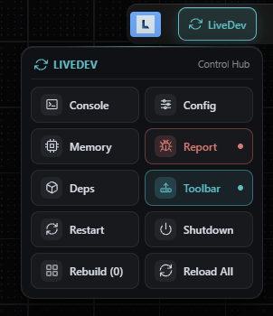
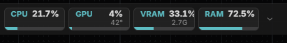
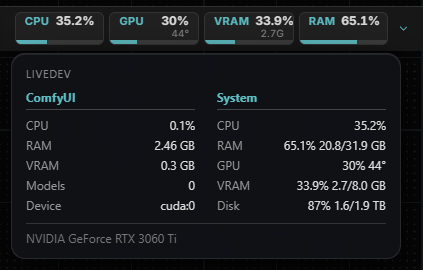
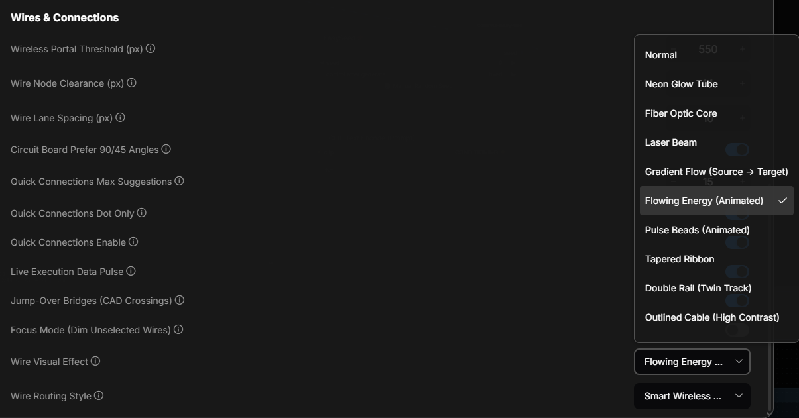
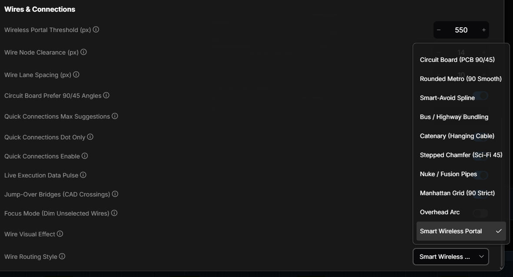
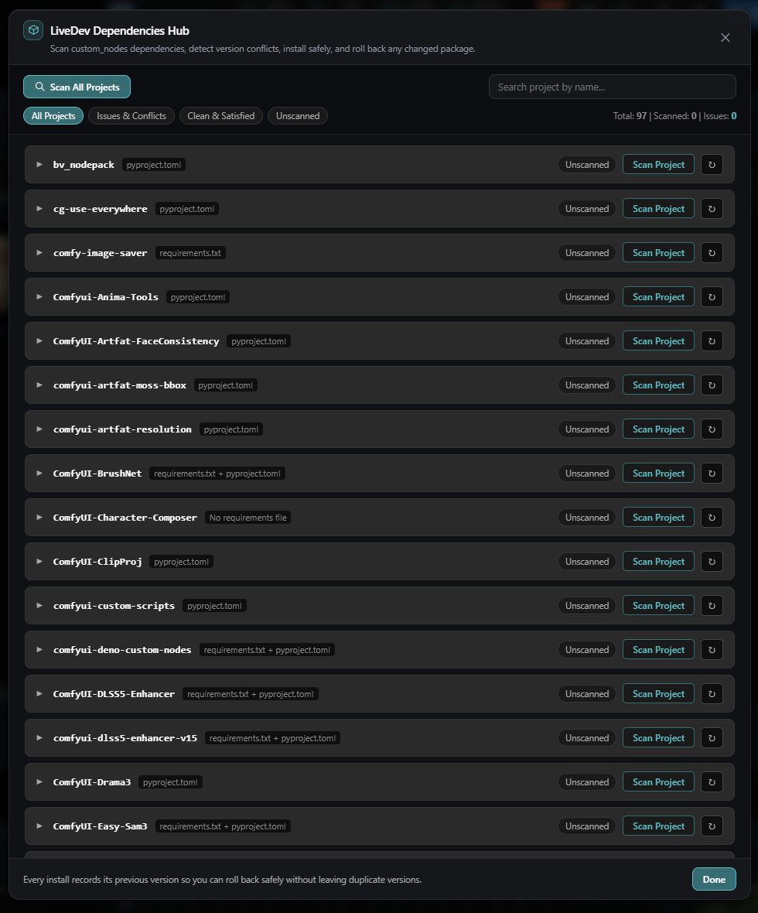

# 🔃 ComfyUI-LiveDev

<p align="center">
  
</p>

<p align="center">
  <strong>Developed by <a href="https://github.com/technokeys-ai">TechnoKeys</a></strong>
</p>

<p align="center">
  <a href="https://github.com/technokeys-ai/ComfyUI-LiveDev/releases"></a>
  <a href="https://registry.comfy.org"></a>
  <a href="https://github.com/technokeys-ai/ComfyUI-LiveDev/blob/main/LICENSE"></a>
  
</p>

A comprehensive development toolkit and workflow power-suite for ComfyUI. Reload custom nodes the moment their code changes, inspect live server logs and system telemetry, resolve dependency conflicts with one-click rollback, customize wire routing and visual effects, and organize large graphs — all without restarting the server.

## Quick Start

1. **Open the Control Hub**: click the **`LiveDev`** button in the top menu bar to access **Console**, **Config**, **Memory**, **Report**, **Deps**, **Toolbar**, **Restart**, **Shutdown**, **Rebuild**, and **Reload All**.
2. **Customize Wires & Effects**: open **`Settings → 🔃 LiveDev → Wires & Connections`** to switch live between **12 Wire Routing Styles**, **16 Wire Visual Effects**, **Quick Connections**, **Focus Mode**, **CAD Jump-Over Bridges**, and **Live Execution Data Pulse**.
3. **Dock or Auto-Hide the Alignment Toolbar**: click the pin toggle on the floating bottom dock (or click **`Toolbar`** in the LiveDev menu) to keep it always visible or show it only when 2+ nodes are selected.

## Visual Showcase

### Control Hub & Live System Telemetry
| LiveDev Control Hub | Live Stats Bar & Detail Popup |
| :---: | :---: |
|  | <br /><br /> |

### Wires & Connections (16 Visual Effects + 12 Routing Styles)
| 16 Wire Visual Effects | 12 Wire Routing Styles |
| :---: | :---: |
|  |  |

### Live Reload Module Config & Dependencies Rollback Hub
| Live Reload Module Config | Dependencies Manager & Rollback Hub |
| :---: | :---: |
|  |  |

## Features

### Live Reload & Watcher
- **Smart content-verified watching**: watches `custom_nodes/` on startup (after a configurable startup grace window, default `10s`) and verifies real edits with SHA-256 content hashing so phantom filesystem writes and cache churn never spam the console.
- **Defer reload while generating**: quietly defers reloads while an image or video prompt is actively executing, then applies cleanly when idle.
- **Syntax safety & rollback**: a module with a syntax error is **refused, not loaded**, keeping the server alive. The last working copy of every module is kept and can be restored from Reload History.
- **Dependency-aware reloads & Reload All**: reloads dependent packs in order, or reloads all watched modules at once when shared helpers change.
- **Stale node detection & one-click Rebuild**: draws a dashed accent border on canvas nodes whose widget schema changed after a reload and exposes **Rebuild (n)** in the LiveDev menu to rebuild them cleanly while preserving values and connections.
- **Live Reload Module Config**: interactive toggle manager (`All` / `Watching` / `Excluded` tabs, instant search, bulk actions) to choose which packs are watched or excluded.

### Wires & Connections
Controlled live from **Settings → 🔃 LiveDev → Wires & Connections**:
- **Quick Connections**: smart glassmorphic slot suggestions beside the cursor when dragging a link for rapid node wiring.
- **12 Wire Routing Styles**: `Default (ComfyUI)`, `Circuit Board (PCB 90/45)`, `Rounded Metro (90 Smooth)`, `Smart-Avoid Spline`, `Bus / Highway Bundling`, `Catenary (Hanging Cable)`, `Stepped Chamfer (Sci-Fi 45)`, `Nuke / Fusion Pipes`, `Manhattan Grid (90 Strict)`, `Overhead Arc`, `Smart Wireless Portal`, and `On Top (Above Nodes)`.
- **16 Wire Visual Effects**: `Normal`, `Neon Glow Tube`, `Fiber Optic Core`, `Laser Beam`, `Gradient Flow (Source -> Target)`, `Flowing Energy (Animated)`, `Pulse Beads (Animated)`, `Tapered Ribbon`, `Double Rail (Twin Track)`, `Outlined Cable (High Contrast)`, `3D Glossy Pipe`, `Glass Tube`, `Circuit Trace (Solder Pads)`, `Dashed Technical`, `Blueprint Dotted`, and `Directional Chevrons`.
- **Composable overlays**: `Focus Mode (Dim Unselected Wires)`, `Jump-Over Bridges (CAD Crossings)`, and `Live Execution Data Pulse` — all route-cached for smooth high-FPS rendering.

### Dependencies Manager & Conflict Rollback Hub
- Scans installed custom nodes for missing packages and version mismatches.
- One-click package installation with automatic pre-install version snapshotting (`conflict_install_log.json`).
- **Rollback / Undo**: revert any installed or upgraded dependency back to its previous version (or uninstall if newly added) directly from the Deps Hub or Rollback History drawer.

### Live Console, Diagnostics & Python REPL
- **Live Console**: mirrors server `stdout` and `stderr` in a browser panel, plus a canvas **Terminal LiveDev** node.
- **Stats Bar**: live CPU, GPU, VRAM, RAM, and Disk telemetry with a glassmorphic detail popup showing ComfyUI process usage, reserved VRAM, loaded models, and active device.
- **Module Conflict Report**: identifies Python module names defined by multiple custom node packs and shows which file Python actually loaded.
- **Error Report Panel**: collects sanitized tracebacks, failing node widgets, console tail, and system figures into a shareable Markdown report (tokens/keys redacted and local paths shortened automatically).
- **Python REPL (off by default)**: opt-in via `LIVEDEV_ENABLE_REPL=1`.

### Alignment Dock, Smart Localization & Node Tools
- **Floating Glassmorphic Alignment Dock**: align, distribute, match size, auto-size, smart auto-layout, bookmarks, node search, batch connect, wire bundles, auto-reroute, workflow templates, node presets, tags, bulk editor, node themes, clean orphaned nodes, fix duplicate node IDs, and **Fix Node / Fix Node (Keep Values)**.
- **Smart Localization Scanner**: scans non-English titles, widgets, dropdown options, slot labels, properties, and groups; defaults **From** to **Auto detect** (`sl=auto`); saves applied translations on nodes and in local translation memory so already-translated fields are never flagged again unless edited.

### Optional, User-Initiated Network Features
- **Localization Translate** sends submitted text to `translate.googleapis.com` only when triggered by the user.
- **Voice Input** uses the browser's Web Speech API (with optional `SpeechRecognition` fallback).
- **ComfyUI Update Check** queries the GitHub releases API only when the LiveDev menu is opened and an updater directory exists.

## Nodes

Both nodes live under **`🔃 LiveDev/`**:
- **🖥 Terminal LiveDev** (`LiveDev_Terminal`) — mirrors the server console output directly onto the canvas.
- **🧹 Clean Memory LiveDev** (`LiveDev_ClearMemory`) — unloads models and frees RAM/VRAM with an `enabled` toggle and optional `trigger` input.

## Settings

All settings live under **Settings → 🔃 LiveDev**, organized into six sections:
1. **Wires & Connections** — Wire Routing Style (12 modes), Wire Visual Effect (16 effects), Focus Mode, CAD Jump-Over Bridges, Live Execution Data Pulse, Quick Connections toggles, and lane/clearance/portal geometry.
2. **Toolbar & UI** — Always Show Alignment Toolbar, Alignment Toolbar Theme (`Auto` / `Dark` / `Light`), and Expand Extra Tools Row.
3. **Live Reload & Watcher** — Start Watching On Launch, Defer Reload While Generating, Reload Dependents, Confirm Before Reload All, Debounce, Watch Extensions, Observe Only Modules, Ignore Patterns, **Live Reload Module Config**, and live **Environment** summary.
4. **Diagnostics & Buffers** — Mark Stale Nodes, Keep Last Error, Reload History Size, Console Buffer Size, and Module Conflict Cache TTL.
5. **Stats Bar** — CPU/GPU/VRAM/RAM toggles, Refresh Rate, Process/ComfyUI detail rows, Compact Stats Bar, Top/Bottom Bar Position, and Disk Root.
6. **Language & Voice** — Voice Language (`en` / `ar`) and default Translate Target Language.

### Environment Variables

| Variable | Meaning |
|---|---|
| `LIVEDEV_EXCLUDE` | Comma-separated module names to add to the exclusion list. |
| `LIVEDEV_OBSERVE_ONLY` | If set, watch only these comma-separated custom node folders. |
| `LIVEDEV_EXTENSIONS` | File extensions to watch (default `.py`). |
| `LIVEDEV_DEBOUNCE_TIME` | Seconds to wait after a file change before reloading (default `1.0`). |
| `LIVEDEV_STARTUP_SETTLE` | Seconds to ignore file events after startup (default `10`). |
| `LIVEDEV_ENABLE_REPL` | Set to `1` to enable the Python REPL (disabled by default). |

## Installation

### Option 1: ComfyUI Manager / Comfy Registry (Recommended)
Search for **`ComfyUI-LiveDev`** in ComfyUI Manager and click **Install**, or install via `comfy-cli`:

```bash
comfy node install comfyui_livedev
```

### Option 2: Git Clone
```bash
cd ComfyUI/custom_nodes
git clone https://github.com/technokeys-ai/ComfyUI-LiveDev.git
pip install -r ComfyUI-LiveDev/requirements.txt
```

### Option 3: Release Archive
Extract `ComfyUI-LiveDev-v1.0.0.zip` into `ComfyUI/custom_nodes/`, install `requirements.txt` if needed, and restart ComfyUI.

## Author

Developed by **TechnoKeys** — [https://github.com/technokeys-ai](https://github.com/technokeys-ai)

## License

MIT — Copyright (c) 2026 TechnoKeys. See [LICENSE](LICENSE).
